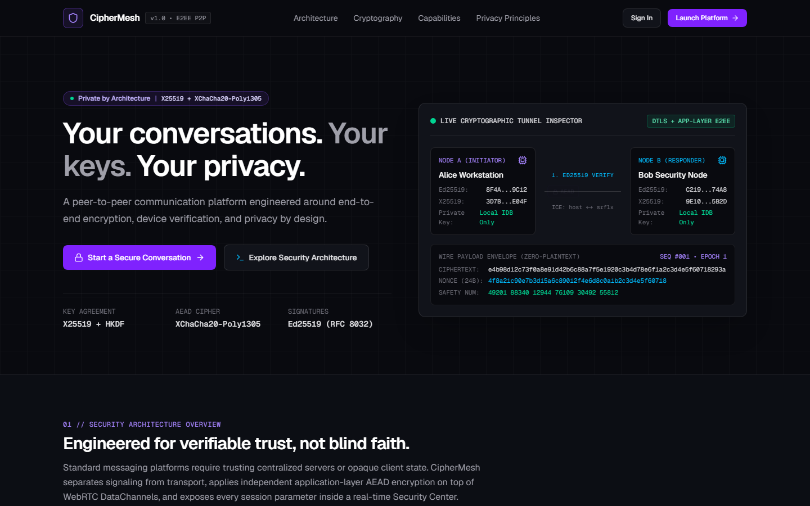
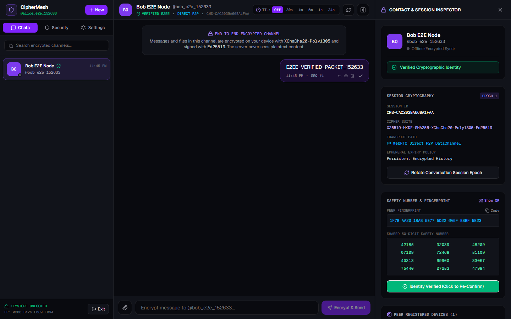
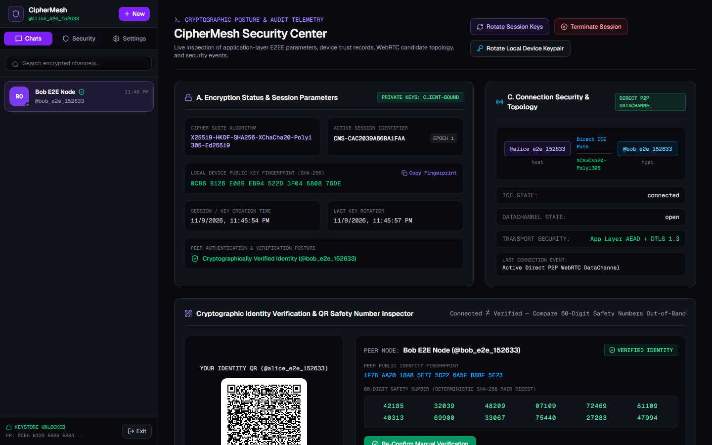
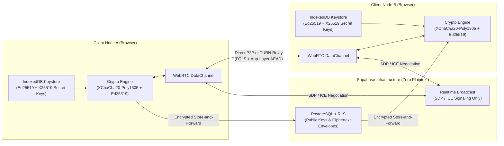

# CipherMesh — Private by Architecture

> **Production-Quality End-to-End Encrypted P2P Communication Platform**
> Engineered around application-layer authenticated encryption (`X25519` + `HKDF-SHA256` + `XChaCha20-Poly1305` + `Ed25519`), WebRTC peer-to-peer transport, cryptographic identity verification, and a transparent Security Center.

---

## Screenshots

| Landing Page & Tunnel Inspector | Encrypted Workspace & Safety Inspector | Cryptographic Security Center |
| :---: | :---: | :---: |
|  |  |  |

---

## 1. Project Overview

**CipherMesh** is an independent cybersecurity and privacy-first communication platform that combines modern real-time peer-to-peer messaging with transparent cryptographic inspection. Unlike conventional chat tools where encryption state is opaque, CipherMesh allows operators to inspect session identifiers, 24-byte nonces, ephemeral X25519 keys, Ed25519 signatures, 60-digit safety numbers, device trust records, and WebRTC candidate topology in real time.

### Key Capabilities
- **Application-Layer End-to-End Encryption:** Powered by Cure53-audited `@noble/curves`, `@noble/hashes`, and `@noble/ciphers` (`X25519-HKDF-SHA256-XChaCha20-Poly1305-Ed25519`), completely independent of WebRTC's transport-layer DTLS.
- **Client-Bound Keystore:** Ed25519 and X25519 private keys are generated locally via `crypto.getRandomValues` and stored in client-side `IndexedDB` (`ciphermesh_keystore_v1`). Private keys never leave the client device.
- **WebRTC P2P DataChannel + Encrypted Store-and-Forward:** Streams encrypted packets and 16 KB encrypted file chunks directly over WebRTC DataChannels (`ciphermesh-e2ee-v1`) when both peers are online, with STUN/TURN configuration support and automatic fallback to encrypted store-and-forward for offline recipients.
- **Contact Identity Verification:** Compare deterministic 60-digit safety numbers or scan/compare JSON QR identity payloads to mark contacts as verified, with automatic alerts if a verified contact's public key fingerprint changes.
- **Encrypted P2P File Transfer:** Drag-and-drop file sharing with per-chunk `XChaCha20-Poly1305` encryption, pause/resume/cancel controls, and whole-file `SHA-256` digest verification prior to download.
- **Configurable Ephemeral Messaging:** Per-conversation disappearing message timers (`30s`, `1m`, `5m`, `1h`, `24h`, or `Off`) enforced in both the client and PostgreSQL Row Level Security policies.
- **Dedicated Security Center:** Live inspection of cipher suites, session IDs, key fingerprints, device trust & revocation controls, ICE candidate topology (`Direct P2P` vs `TURN Relay` vs `Store-and-Forward`), and a real-time security event audit log.

---

## 2. Technology Stack

- **Frontend:** Next.js 16 (App Router), TypeScript (Strict Mode), Tailwind CSS v4, Framer Motion, Lucide Icons, `qrcode.react`
- **Cryptography:** `@noble/curves` (`Ed25519`, `X25519`), `@noble/hashes` (`HKDF-SHA256`, `SHA-256`), `@noble/ciphers` (`XChaCha20-Poly1305`)
- **Transport & Signaling:** WebRTC `RTCPeerConnection` & `RTCDataChannel`, Supabase Realtime Broadcast & Presence
- **Database & Auth:** Supabase PostgreSQL with Row Level Security (RLS), Supabase Auth (`@supabase/ssr`)
- **Testing:** Vitest (Unit & Live Database/RLS Security Integration Tests), Playwright (Multi-Browser E2E Verification)
- **Deployment:** Vercel

---

## 3. Architecture Diagram



---

## 4. Detailed Documentation (`docs/`)

- [`docs/ARCHITECTURE.md`](docs/ARCHITECTURE.md) — System topology, P2P signaling separation, and transport layers.
- [`docs/CRYPTOGRAPHY.md`](docs/CRYPTOGRAPHY.md) — Key agreement (`X25519`), key derivation (`HKDF-SHA256`), AEAD (`XChaCha20-Poly1305`), signatures (`Ed25519`), safety numbers, and replay protection.
- [`docs/THREAT-MODEL.md`](docs/THREAT-MODEL.md) — Protected assets, trust boundaries, adversary profiles, mitigations, and residual risks.
- [`docs/DATABASE.md`](docs/DATABASE.md) — Normalized schema, Row Level Security (RLS) policies, and metadata disclosure.
- [`docs/SECURITY.md`](docs/SECURITY.md) — CSP headers, rate limiting, and security test verification.
- [`docs/DEPLOYMENT.md`](docs/DEPLOYMENT.md) — Vercel & Supabase production deployment and TURN configuration.

---

## 5. Local Development & Installation

### Prerequisites
- Node.js 20.19+ or 24.x
- A Supabase project

### Setup
1. Clone the repository and install dependencies:
   ```bash
   git clone https://github.com/GorillaBrain/ciphermesh.git
   cd ciphermesh
   npm install
   ```
2. Copy `.env.example` to `.env.local` and configure your Supabase URL and Anon Key:
   ```bash
   cp .env.example .env.local
   ```
3. Start the development server:
   ```bash
   npm run dev
   ```
4. Open `http://localhost:3000`.

---

## 6. Testing & Security Verification

CipherMesh includes unit, integration, security/RLS, and multi-browser end-to-end tests:

```bash
# Run cryptographic unit tests + live Supabase RLS & tamper security tests
npm test

# Run multi-browser Playwright E2E test suite
npm run test:e2e
```

---

## 7. Security Limitations & Honest Disclosures

- **Protocol Scope:** CipherMesh implements authenticated `X25519 + per-message ephemeral HKDF-SHA256 + XChaCha20-Poly1305 + Ed25519` encryption with explicit session epoch rotation. It does not claim Signal Double Ratchet compatibility.
- **Network Topology:** Not every WebRTC connection is direct P2P; peers behind symmetric NATs require a configured TURN relay or automatically use encrypted store-and-forward delivery.
- **Disappearing Messages:** Ephemeral timers purge messages across honest clients and filter expired records via database RLS, but cannot prevent external cameras or OS-level screenshots by a recipient.
- **Browser Endpoint Security:** Private keys are stored in client-side `IndexedDB` and depend on the integrity of the user's endpoint OS and browser environment.
