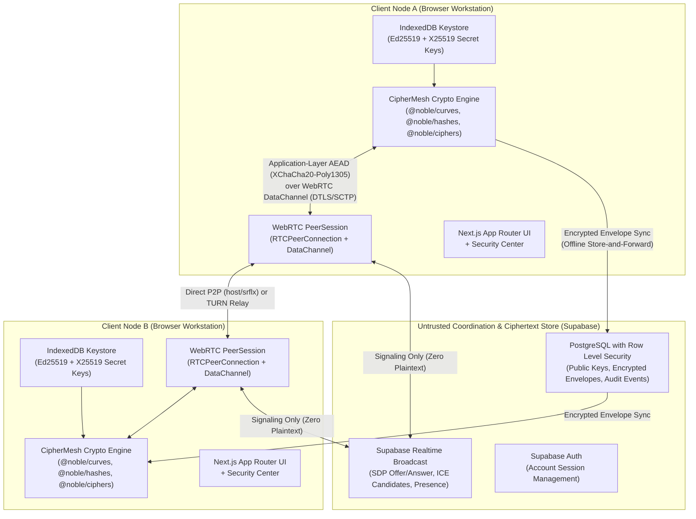

# CipherMesh — System Architecture (`ARCHITECTURE.md`)

**Tagline:** *Private by Architecture.*

CipherMesh is an end-to-end encrypted peer-to-peer (E2EE P2P) communication platform engineered so that cryptographic identity generation, key agreement, authenticated encryption, and signature verification execute strictly on the client device.

---

## 1. High-Level Architectural Topology

---

## 2. Core Architectural Principles

1. **Strict Separation of Signaling and Plaintext:**
   Supabase Realtime is used to exchange WebRTC session descriptions (SDP Offer/Answer) and ICE candidates, as well as online presence and typing signals. Plaintext message content is never sent to the signaling server.
2. **Defense-in-Depth Dual Encryption:**
   WebRTC DataChannels provide transport-layer DTLS-SRTP/SCTP encryption. CipherMesh implements a completely independent application-layer E2EE envelope (`X25519-HKDF-SHA256-XChaCha20-Poly1305-Ed25519`) before any payload touches the WebRTC DataChannel or store-and-forward database. Even if a TURN relay or database is inspected, only authenticated ciphertext is present.
3. **Client-Bound Private Keys:**
   Private keys (`ed25519SecretKeyHex`, `x25519SecretKeyHex`) are generated locally via CSPRNG (`crypto.getRandomValues`) and persisted in the browser's `IndexedDB` (`ciphermesh_keystore_v1`). Only signed public keys and SHA-256 fingerprints are published to the backend directory.
4. **Hybrid P2P + Encrypted Store-and-Forward:**
   - When both peers have an open `RTCDataChannel` (`ciphermesh-e2ee-v1`), encrypted envelopes and encrypted 16 KB file chunks stream directly peer-to-peer.
   - When a peer is offline or behind a restrictive firewall where direct ICE fails, encrypted envelopes are persisted in `public.encrypted_messages` and delivered asynchronously upon reconnection.
5. **Honest Topology Telemetry:**
   CipherMesh inspects `RTCPeerConnection.getStats()` candidate pairs (`host`, `srflx`, `prflx`, `relay`) in real time and reports whether the session is **Direct P2P**, **TURN-Relayed**, or **Encrypted Store-and-Forward**. It never claims every connection is direct P2P.
